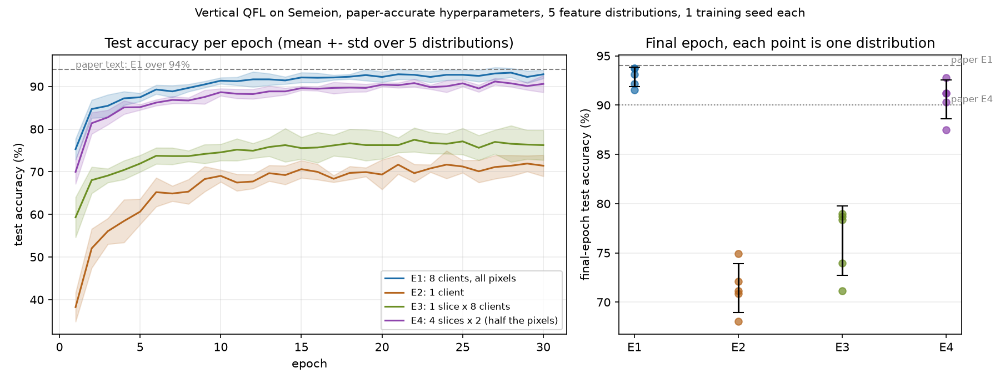
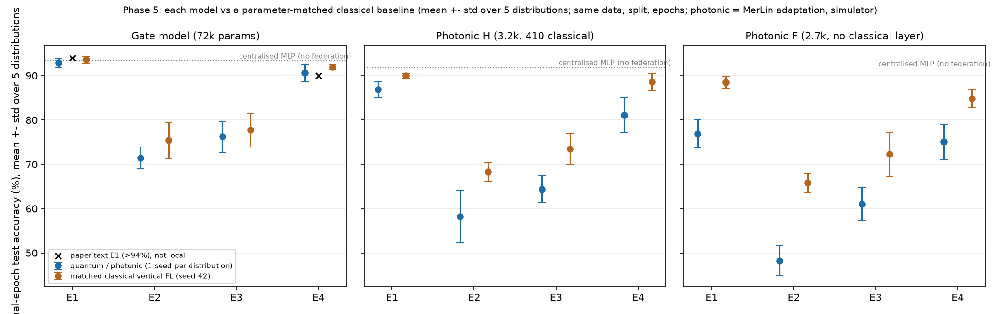
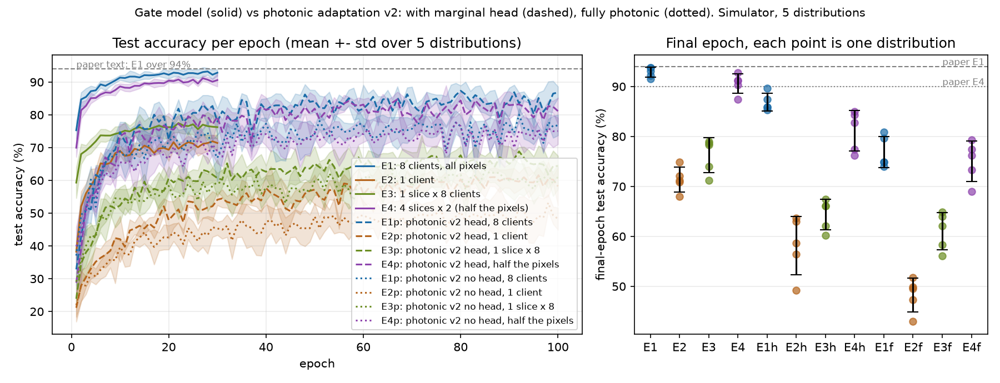

# Vertical Quantum Federated Learning — Reproduction

Reproduction of *Vertical Quantum Federated Learning* (Ballester, Blum, Cerquides, Artiles; ICEA '25).

**Status.**
- **Reproduction:** all four experiments of the paper are reproduced at paper scale, and they agree with the authors' released result files to within 1.4 points.
- **Paper value not reached:** the paper's "over 94%" for the 8-client model is not reached at the final epoch (92.85%).
- **Classical baseline:** a parameter-matched classical vertical-FL model reaches the same accuracy (93.61%). There is no evidence of a quantum advantage, which the paper does not claim.
- **Photonic adaptation:** a MerLin photonic version (status `MERLIN_IMPLEMENTATION`) preserves the paper's comparative structure. It reaches 86.83% with a small classical readout and 76.87% fully photonic, below its matched classical baselines.

## Reference and Attribution

- Paper: Rocco Ballester, Christian Blum, Jesus Cerquides, Luis Artiles, *Vertical Quantum Federated Learning*, Proceedings of ICEA '25 (Melbourne, December 2025), pp. 66-71. DOI: https://doi.org/10.1145/3803817.3803821 (open access, CC BY 4.0).
- Original repository: https://github.com/roccobb/VQFL (commit cba23d4). It has no license file, so it is used only as read-only reference material: kept under `data/vertical_qfl/`, not redistributed, and only needed by two optional tests.
- All code in this folder is an independent implementation.

## Original Paper

The paper studies **vertical (feature-partitioned) federated learning with quantum models**, which it presents as the first quantum version of vertical FL.

- **Clients:** each client holds a disjoint, randomly chosen subset of the pixels of the same images. It runs an 8-qubit data re-uploading circuit on them and sends 8 expectation values to a server.
- **Server:** the server holds the labels. It runs its own 8-qubit circuit on the concatenated messages and outputs 10 class scores.
- **Training:** end to end. The server sends the gradient with respect to the messages back to the clients.
- **Selling points:** fully quantum models with no classical layers and no classical data reduction, privacy by construction, and suitability for NISQ hardware.
- **Setup:** TorchQuantum simulation on the Semeion digits (1593 images, 16×16, 10 classes), with 8000 trainable angles per model and 5 random feature distributions.

| Experiment | Layout | Reported |
|---|---|---|
| E1 (Fig. 2) | 8 clients, disjoint 32-pixel slices | "over 94%" |
| E2 (Fig. 2) | 1 client (1/8 of the pixels) | clearly lower |
| E3 (Fig. 3) | 1 slice duplicated over 8 clients (server input matched to E1) | moderately above E2 |
| E4 (Fig. 3) | 4 slices, each duplicated twice (half the pixels) | about 90%, slightly below E1 |

## Reproduction Scope, Claims, and Deviations

**Claims tested:**
- **C1:** E1 reaches over 94%.
- **C2:** 8 clients beat 1 client.
- **C3:** the gain comes from distinct features, not from a wider server input.
- **C4:** half the pixels is only slightly worse.
- **C5:** the results are robust across feature distributions.

**Not tested:** C6 (privacy) and C7 (NISQ suitability). The paper argues them and does not measure them.

**What was done:**
1. **Gate-model reproduction (Phases 2-3):** E1-E4 with the paper's hyperparameters. That is 8 qubits, D = 5 blocks of L = 100 layers, Adam with lr 0.002, batch 32, 30 epochs, a stratified 80/20 split, and permutation seeds 42-46. Each experiment uses 5 distributions with 1 training seed.
2. **Photonic adaptation (Phase 4):** a separate MerLin model, labelled as an adaptation throughout.
3. **Fair classical baselines (Phase 5):** independent controls with matched parameters. They are not part of the paper.

**Deviations:**
- **Simulator.** TorchQuantum 0.1.8 does not install cleanly (it has qiskit version conflicts), so `lib/statevector.py` is a small PyTorch statevector simulator with TorchQuantum's conventions. It matches a dense numpy reference to 1e-10, and it reproduces the authors' trained 8-client model exactly: 0.9373 test accuracy, the same as their recorded value.
- **Details taken from the authors' code.** The paper leaves these out, so they come from the authors' notebooks: 30 epochs, the circuit layout (4 encoding blocks), and the 10-logit readout (⟨Z⟩ and ⟨X⟩ on qubits 0-4). Two further details also come from the code:
  - **The loss applies softmax before cross-entropy.** A control without the softmax gave the same accuracy.
  - **The 1-client experiment uses a narrower server.**
- **Data split.** The split and permutations are identical to the authors' tensors (checked by a test).

## Project Layout

```text
lib/statevector.py       PyTorch statevector simulator (gate model)
lib/model.py             gate-model VQFL (clients + server circuits)
lib/model_merlin.py      MerLin photonic adaptation (Phase 4)
lib/model_classical.py   classical vertical-FL and centralised baselines (Phase 5)
lib/data.py              Semeion loading, permutation, split, dataloaders
lib/runner.py            train_and_evaluate (all backends), logging, metrics
utils/                   sweep coordinator, selection, statistics, comparison and plotting scripts
configs/                 *_original (paper), *_merlin_* (photonic), classical/ (baselines), defaults (smoke)
tests/                   45 tests
results/                 curated tables and figures
outdir/                  raw runs and sweeps (disposable, not committed)
```

## Install and How to Run

```bash
# from the repository root (Python 3.11)
python3.11 -m venv .venv && source .venv/bin/activate
pip install -r papers/vertical_qfl/requirements.txt
```

Quick smoke runs (seconds, not results):

```bash
python implementation.py --paper vertical_qfl --config configs/defaults.json
cd papers/vertical_qfl && python -m pytest -q
```

Full runs (one feature distribution; use `--permutation-seed 42` to `46` for the paper's five):

```bash
# gate model, paper settings (about 21 min alone on an Apple M5 CPU)
python implementation.py --paper vertical_qfl --config configs/e1_8clients_original.json --permutation-seed 42
# photonic adaptation (about 16 min), with readout head or fully photonic
python implementation.py --paper vertical_qfl --config configs/e1_8clients_merlin_head.json --permutation-seed 42
python implementation.py --paper vertical_qfl --config configs/e1_8clients_merlin_photonic.json --permutation-seed 42
# classical baseline matched to the gate model (seconds)
python implementation.py --paper vertical_qfl --config configs/classical/gate_e1_8clients.json --permutation-seed 42
# all five distributions as a logged sweep (sweep.log, sweep_status.json, summary.json)
python papers/vertical_qfl/utils/run_distributions.py --config configs/e1_8clients_original.json --permutation-seeds 42 43 44 45 46 --workers 5 --threads 2
```

## Configuration

- **Authoritative flag list:** `cli.json`. The paper-specific flags are `--permutation-seed`, `--epochs`, `--lr`, `--batch-size`, `--depth-per-block`, `--client-encoding-scale`, `--max-train-samples` and `--max-test-samples`. The global flags include `--seed`, `--data-root` and `--outdir`.
- **`configs/defaults.json`:** a lightweight smoke run (2 layers per block, 2 epochs, 64/32 samples). It is **not** paper-accurate.
- **Gate model:** `configs/e{1..4}_*_original.json`, with the paper settings. `configs/e1_8clients_logits_control.json` is the loss control.
- **Photonic adaptation:** `configs/e*_merlin_head.json` and `configs/e*_merlin_photonic.json` are the final v2 designs. `configs/e*_merlin.json` is the first design (v1), and the `*_tuning` and `*_diagnostic*` configs are the selection sweeps.
- **Classical baselines:** `configs/classical/<size>_<layout>.json`, generated by `utils/make_classical_configs.py` from the frozen matching table.
- **Run outputs:** each run writes `outdir/run_*/` with `run.log`, `run_status.json`, `config_snapshot.json` and `metrics.json`.

## Data

- **Dataset:** Semeion Handwritten Digit (UCI, 1593 images of 16×16 binary pixels, CC BY 4.0), stored at `data/vertical_qfl/semeion/semeion.data`.
- **Re-download:** `curl -L -o semeion.zip https://archive.ics.uci.edu/static/public/178/semeion+handwritten+digit.zip`, then unzip into that folder.
- **Preprocessing:** pixels become rotation angles in {0, π/4}, as in the authors' code. The columns are permuted with `torch.manual_seed(permutation_seed)`, then a stratified 80/20 split uses `random_state = 42`, giving 1274 training and 319 test images.

## Results Obtained and Comparison with the Paper

**Scope:**
- **Gate-model results:** `paper-accurate hyperparameters`, 5 feature distributions, 1 training seed each.
- **Test set:** a single 319-image test set. One image is 0.31 points, and the binomial standard error of one run is about 1.4 points.
- **Metric:** final-epoch test accuracy, with ± the sample standard deviation over the 5 distributions.
- **Selection:** the paper has no validation split, so best-epoch values are selected on the test set and are shown only as such.

| Paper item | Claim tested | Paper value | Reproduced value | Delta | Metric agreement | Trend agreement | Claim support | Seeds | Comment |
|---|---|---:|---:|---:|---|---|---|---:|---|
| Fig. 2, E1 (8 clients) | C1 | >94% | 92.85 ± 0.98% | about −1.2 | not reached at the final epoch; matches the authors' files (93.04%, −0.19) | yes | partially supported | 5 × 1 | ">94%" holds only as the test-selected peak of the authors' mean curve (94.04%); ours peaks at 93.23% |
| Fig. 2, E2 (1 client) | C2 | lower than E1 (no number) | 71.41 ± 2.48% | n/a | matches the authors' files (70.03%) | yes | supported | 5 × 1 | E1 − E2 = +21.4 points, positive in 5/5 |
| Fig. 3, E3 (1 slice × 8) | C3 | between E2 and E1 | 76.24 ± 3.50% | n/a | matches the authors' files (76.30%) | yes | supported | 5 × 1 | E3 − E2 = +4.8 and E1 − E3 = +16.6 points, both positive in 5/5 |
| Fig. 3, E4 (half the pixels) | C4 | about 90% | 90.60 ± 1.97% | about +0.6 | quantitatively consistent | yes | supported | 5 × 1 | E1 − E4 = +2.3 points (p ≈ 0.14), not distinguishable from zero |
| Figs. 2-3, spread | C5 | variance over 5 distributions | std 1.0-3.5 points | n/a | n/a | yes | supported | 5 × 1 | the ordering E1 > E4 > E3 > E2 holds in the mean |
| Loss choice (authors' code) | ambiguity | n/a | E1 with plain logits 92.85 ± 0.34% | 0.00 paired | n/a | n/a | no effect | 5 × 1 | E1 only |

**Provenance:**
- **Paper values** come from the text (the figures carry no tables).
- **Authors' values** are `all_test_acc[-1]` from their released result JSONs.
- **Generated outputs:** `results/statistics.md` and `results/statistics.json`, from `utils/aggregate_results.py`, and the figure `results/accuracy_comparison.png`.



**Sweeps:**
- **Experiment sweeps:** every experiment is a logged sweep over the 5 distributions, 25 runs in total including the loss control. All are COMPLETE SWEEPs, and all were validated by the experiment-logging validator.
- **Selection and diagnostic sweeps:** the photonic tuning (T1, T2), the photonic diagnostics (D1-D3) and the classical learning-rate selection (C-T).
  - **Rules:** each was declared before its runs. The metric is final-epoch validation accuracy, maximised, as a mean over the seeds, with a tie tolerance of 0.5 points.
  - **Results:** all are COMPLETE SWEEPs. `results/selection_sweeps.md` has the **complete candidate tables**, with JSON copies in `results/sweeps/`. The selections are in `results/photonic_selection.json` and `results/classical_selection.json`.

## Fair Baselines

**Why a new baseline was needed.**
- The paper's own controls (E2-E4) fix the per-model budget and change only the factor under test. They are fair for C2-C4 and were reproduced, so they are reused.
- The paper has **no classical comparator**, so a classical vertical-FL baseline was added. This was planned in Phase 1 and frozen in `LOG.md` before any baseline run.

**The baseline (`lib/model_classical.py`):**
- Each client is a one-hidden-layer ReLU MLP on its own 32-pixel slice and sends 8 tanh-bounded values. The server is a one-hidden-layer MLP that outputs 10 logits.
- It uses the same partitions, data, split, binary-pixel information, Adam optimiser, batch size, epoch budget of the matched system, and last-epoch checkpoint.
- **Parameters are matched** per party and in total, to within ±6%:
  - against the gate model: 72,059 vs 72,000;
  - against photonic H: 3,270 vs 3,154;
  - against photonic F: 2,895 vs 2,744.
- The learning rate is selected on a validation split over {0.001, 0.002, 0.005, 0.01}.
- A centralised MLP on all 256 pixels (no federation) is shown as a reference.
- There are 225 runs: 5 distributions × 3 training seeds per configuration.

| Layout | Gate model | Classical, matched | Photonic H | Classical, matched | Photonic F | Classical, matched |
|---|---|---|---|---|---|---|
| E1, 8 clients | 92.85 ± 0.98 | 93.61 ± 0.79 | 86.83 ± 1.77 | 89.97 ± 0.59 | 76.87 ± 3.15 | 88.53 ± 1.39 |
| E2, 1 client | 71.41 ± 2.48 | 75.42 ± 4.05 | 58.18 ± 5.85 | 68.28 ± 2.12 | 48.28 ± 3.36 | 65.89 ± 2.14 |
| E3, 1 slice × 8 | 76.24 ± 3.50 | 77.74 ± 3.81 | 64.39 ± 3.09 | 73.48 ± 3.54 | 61.07 ± 3.74 | 72.29 ± 4.97 |
| E4, half the pixels | 90.60 ± 1.97 | 91.97 ± 0.57 | 81.13 ± 4.05 | 88.59 ± 1.95 | 75.05 ± 4.03 | 84.83 ± 2.01 |
| Centralised MLP (reference) | | 93.29 ± 0.72 | | 91.79 ± 0.41 | | 91.54 ± 0.50 |

**How to read the table:**
- **Values:** final-epoch test accuracy (%), mean ± std over 5 distributions. Classical values use training seed 42 and are paired with the quantum or photonic run on the same distribution. Using all 3 seeds changes them by at most 1.7 points.
- **Source:** `python utils/compare_baselines.py --sweeps results/phase5_sweeps.json` generates `results/phase5_comparison.md` and `.json`, and the figure is `results/phase5_comparison.png`.
- **Wall-clock per run (median, 5 runs in parallel on an Apple M5 CPU):**
  - classical: 1-4 s;
  - gate model: about 1600 s at E1;
  - photonic: about 960 s at E1.
  - This gap is simulation cost, not algorithmic cost.



**Outcomes** (the pairwise rule was declared in advance; with n = 5, p-values are indicative):
- **No quantum advantage.** The gate model and its matched classical counterpart are **not clearly different** by the rule (E1: −0.75 points, p = 0.08). The classical model is numerically ahead in all four layouts, with the quantum model ahead in only 0-1 of 5 distributions.
- **The paper's ablation pattern is a property of vertical FL, not of quantum models.** The classical model shows the same pattern: 8 clients beat 1 by 18 points, distinct features matter more than a wider server, and half the pixels is only slightly worse.
- **The photonic adaptation is below its matched classical baseline in every layout:** by 3.1-10.1 points for H and 9.8-17.6 points for F.
- **Caveats:**
  - The classical learning rate was tuned on validation data, while the gate model kept the paper's untuned values.
  - There is one quantum training seed per distribution.

## Photonic Assessment and MerLin Extension

**Status `MERLIN_IMPLEMENTATION`, an adaptation (not a reproduction).**
- **Code:** `lib/model_merlin.py`, selected with `model.backend = "merlin"`.
- **Architecture:** each party (client or server) is one 8-mode, 4-photon chip. Each chip alternates trainable interferometer meshes (`add_entangling_layer`) with angle encodings of 8 inputs (`add_angle_encoding`), which is data re-uploading.
- **What is preserved:** the vertical federated structure and the E1-E4 comparison, not the gate-level circuit.
- **Rejected alternatives:**
  - dual-rail emulation of the 8 qubits, for resource cost;
  - a classical embedding feeding a photonic classifier, because it adds classical layers;
  - one central chip, because it is not federated.

**Final designs (v2):**
- **H:** clients send mean photon numbers, and the server reads out through a 410-parameter linear head on per-mode photon-number marginals.
- **F:** fully photonic. Clients send click probabilities from threshold detectors, and the server applies a fixed grouping of its 330 outcomes.
- **Settings:** encoding scale π/8 and learning rate 0.01 (selected on validation in T1/T2), and 100 epochs.

| Experiment | Gate model | Photonic H | Photonic F | First photonic design (v1) |
|---|---|---|---|---|
| E1, 8 clients | 92.85 ± 0.98% | 86.83 ± 1.77% | 76.87 ± 3.15% | 70.22 ± 4.15% |
| E4, 4 clients × 2 | 90.60 ± 1.97% | 81.13 ± 4.05% | 75.05 ± 4.03% | 70.78 ± 1.75% |
| E3, 1 slice × 8 | 76.24 ± 3.50% | 64.39 ± 3.09% | 61.07 ± 3.74% | 54.04 ± 2.93% |
| E2, 1 client | 71.41 ± 2.48% | 58.18 ± 5.85% | 48.28 ± 3.36% | 48.65 ± 2.89% |

Labels: `photonic adaptation, simulator, tuned`, 5 distributions with 1 seed each. Trainable parameters at E1: gate model 72,000; H 3,154, of which 410 are classical; F 2,744, all photonic. Statistics are in `results/photonic_v2_statistics.md` and the figure is `results/photonic_v2_vs_gate.png`.



**Findings:**
- **The paper's comparative structure is preserved in both designs.** All the criteria declared before the runs were met: E1 beats E2 and E3 in 5/5 distributions, E4 beats E3 in 5/5, and E3 is at least E2 in 4/5 or more.
- **The gap to the gate model narrowed from 22.6 points (v1) to 6.0 points (H) at E1.** The fully photonic design (F) is 16.0 points below.
- **How v2 was found.** These diagnostics were run on validation data only, and the full tables are in `results/selection_sweeps.md`:
  - **Readout:** a fixed grouping of the outcomes was the bottleneck, as `papers/distributed_qml_cc` had found. A trainable head gave +5.3 points.
  - **Training length:** 30 epochs was too short. 100 epochs gave +4.8.
  - **Server size:** a larger server chip helped a little (+2.9).
  - **Computation space:** `FOCK` removes post-selection but by itself did not add accuracy.
  - **Client message:** mean photon numbers in `FOCK` carry only single-photon interference, and are exactly constant with one photon per mode. Click probabilities carry multi-photon interference.
  - **Variations that didn't help:** 8 photons instead of 4, and re-uploading the data twice.
- **MerLin behaviours found:**
  - `UNBUNCHED` keeps only collision-free outcomes and renormalises them, which is post-selection, not threshold detection.
  - An angle-encoding name ending in a digit silently ignores `scale`.

## Hardware-Aware Settings

| Field | v2 H | v2 F | v1 (superseded) |
|---|---|---|---|
| Computation space | `FOCK` | `FOCK` (simulation) | `UNBUNCHED` |
| Detector model | photon-number-resolving (clients and server) | threshold on clients, photon-number-resolving on the server | collision-free post-selection |
| Photons / modes per party | 4 / 8 | 4 / 8 | 4 / 8 |
| Input state | [1,0,1,0,1,0,1,0] | same | same |
| Encoding | angle encoding: 4 client stages (32 binary pixels × π/8), 8 server stages (64 values × π) | same | same |
| Measurement | clients `mode_expectations`; server photon-number marginals → linear head | clients click probabilities; server `LexGrouping(330, 10)` | clients `mode_expectations`; server `LexGrouping(70, 10)` |
| Postselection | none | none | collision-free outcomes, renormalised |
| Simulator / QPU | MerLin CPU analytic simulator (`merlinquantum` 0.4.2, whose `merlin.__version__` reports 0.4.1); no QPU | same | same |
| Shots | not applicable (exact probabilities) | same | same |
| Gradients | exact autograd | same | same |
| Noise | none | none | none |
| Wall-clock per run | about 16 min (E1, 5 in parallel) | 16-23 min | about 5 min (30 epochs) |
| Seeds | training 42; permutation 42-46 | same | same |

These are simulator results, not hardware validation.

## Limitations

- **Gate model:**
  - One training seed per feature distribution, so initialisation variance is not separated.
  - One 319-image test set.
  - The paper's figures give no numbers for E2 and E3, so those comparisons rely on the authors' result files.
- **Photonic adaptation:**
  - Designs and hyperparameters were selected on E1 validation data with 2 seeds and reused for E2-E4.
  - The encoding scale and learning rate were not re-tuned for `FOCK`.
  - Accuracy oscillates by about ±5 points between epochs at lr 0.01, so final-epoch values are noisy.
  - `FOCK` assumes photon-number-resolving detectors.
  - Simulator only.
- **Baselines:** the classical learning rate was tuned while the gate model used the paper's values. Semeion is the only dataset.
- **Not tested at all:** the privacy and NISQ claims.

## Tests

`cd papers/vertical_qfl && python -m pytest -q` runs 45 tests:
- CLI and configs;
- the simulator against a dense 256×256 numpy reference;
- the data split against the authors' tensors;
- the authors' trained weights reproducing their accuracy;
- the photonic model (shapes, gradients, computation space, scale, readouts, the post-selection and one-photon-per-mode pitfalls);
- the classical baselines (parameter matching, shapes, seeding, config wiring);
- smoke runs through the shared runtime.

## Citation and License

Please cite the paper: R. Ballester, C. Blum, J. Cerquides, L. Artiles, "Vertical Quantum Federated Learning", ICEA '25, ACM, 2025, https://doi.org/10.1145/3803817.3803821. The Semeion dataset is from the UCI Machine Learning Repository (CC BY 4.0). This reproduction's code follows the repository license.
